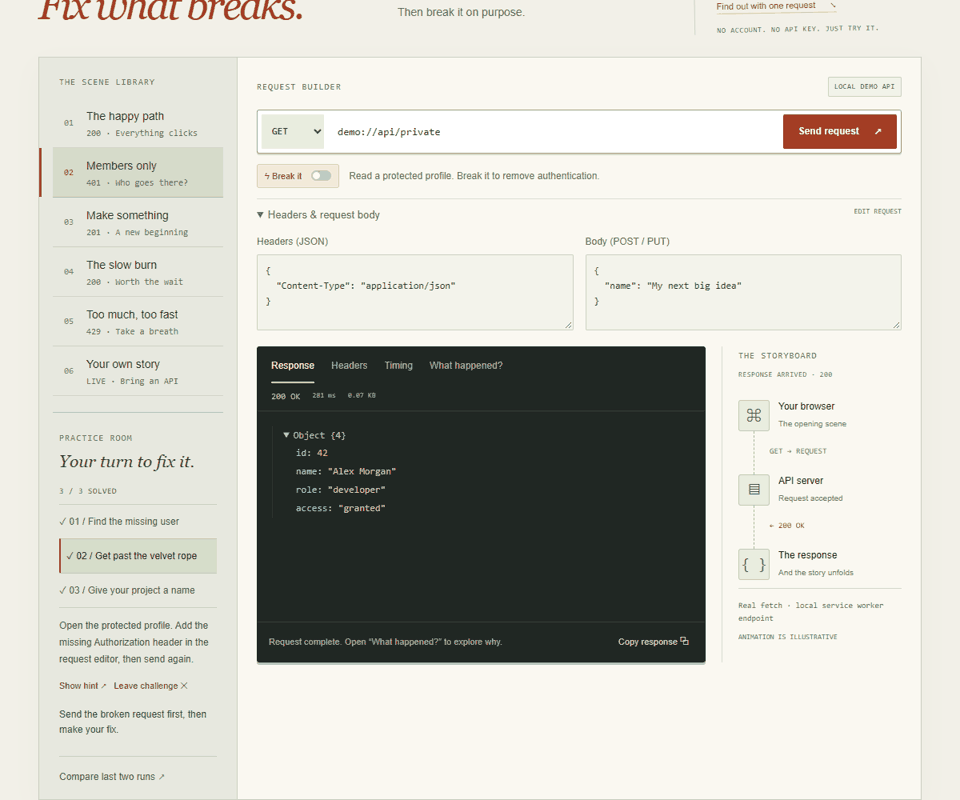
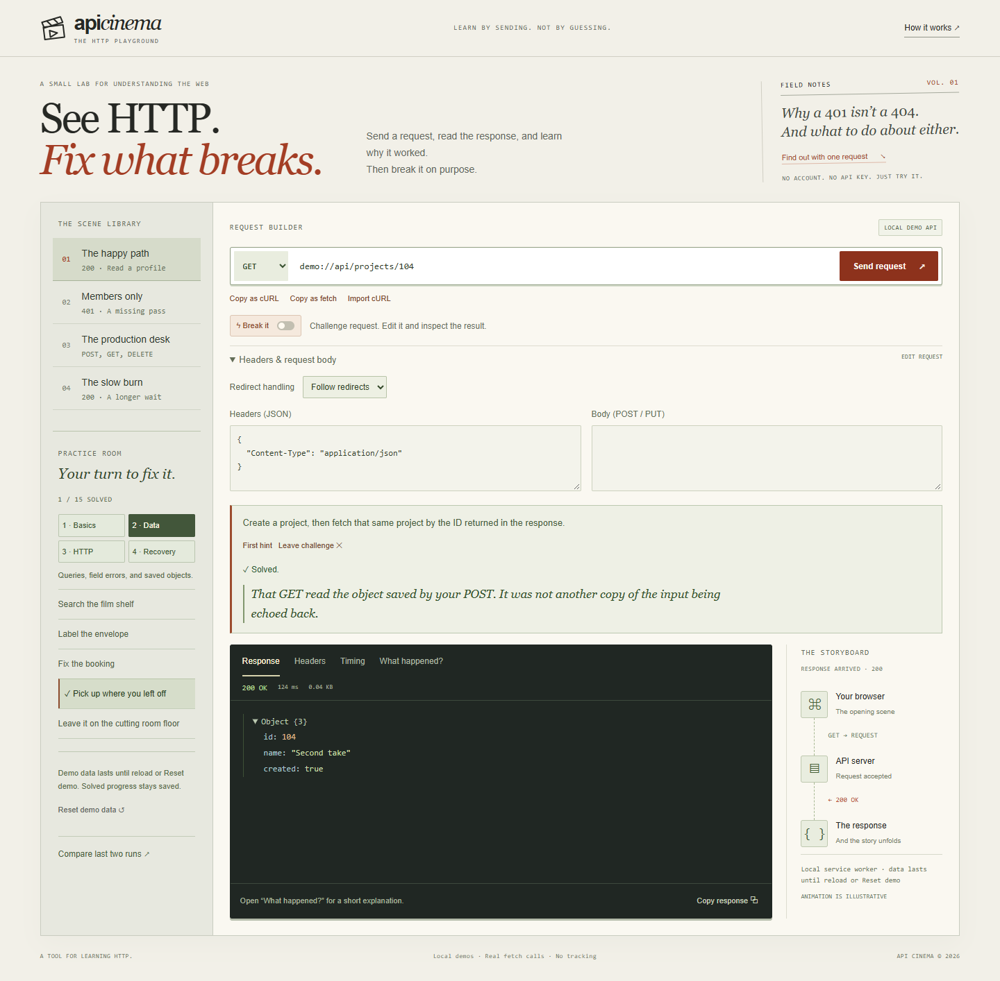
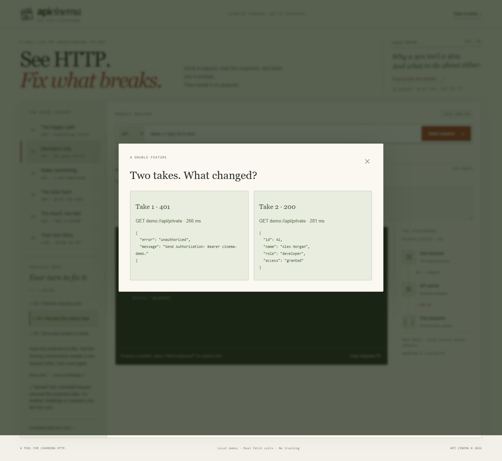
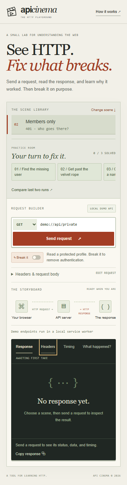
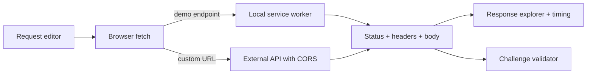

<div align="center">

# API Cinema

### See HTTP. Fix what breaks.

An interactive HTTP playground. Send requests, watch the journey, and fix what breaks.

[**Open the live playground →**](https://ran-nope.github.io/api-cinema/)

**Vanilla JavaScript · Service Workers · Zero dependencies · MIT license**



</div>

## Why it exists

API errors are easier to understand when you can cause them, inspect them, and fix them yourself. API Cinema makes HTTP tangible through editable requests and guided challenges.

## Try this first

1. Choose **Get past the velvet rope** under Practice Room.
2. Send the request and inspect **401 Unauthorized**.
3. Open the hint and add `"Authorization": "Bearer cinema-demo"` to the Headers JSON.
4. Send again. See **200 OK** and solve the challenge.
5. Click **Compare last two runs** to inspect the difference.

## Features

| Feature | What you can do |
| --- | --- |
| Guided challenges | Repair a URL, authentication header, or JSON body. Validation checks the submitted request and expected response. |
| Visual journey | Follow animated method and status packets and see results such as GET → 401 Unauthorized. |
| Built-in scenes | Explore 200, 201, 400, 401, 404, 405, 429, and 504 outcomes. |
| Break it mode | Remove authentication, corrupt JSON, request a missing resource, or trigger a timeout. |
| Response explorer | Expand JSON, inspect headers, copy data, and read explanations. |
| Timing | Inspect measured wait for headers, body reading, and total fetch time. |
| Comparison | Compare the last two responses, status codes, and timings. |
| Custom requests | Send GET, POST, PUT, and DELETE to browser-accessible APIs. |
| Local progress | Keep solved challenge IDs on this device. Requests remain in memory. |
| Responsive layout | Desktop and mobile, keyboard controls, reduced-motion support. |



<details>
<summary>See comparison and mobile layout</summary>





</details>

## Run locally

Requires Node.js 18 or newer. No dependencies or API keys.

```sh
node server.cjs
```

Open **http://localhost:4173**. Service workers require localhost or HTTPS; opening index.html directly will not run demos.

## Architecture



Demo addresses beginning with demo:// are translated into same-origin /__demo/ requests. The service worker handles actual fetch calls and returns Response objects containing JSON, status codes, headers, and intentional delays.

Challenges check the submitted method, URL, headers or body, and returned data. A successful response from an unrelated endpoint does not solve a challenge. Only solved challenge IDs are stored in localStorage; the last ten responses remain in memory until reload.

### Scope and limitations

- Built-in endpoints run on your device, not a remote server. Project creation echoes data without storing it.
- Authentication checks a fixed demo token, not a production identity system. Rate limiting always returns 429. The timeout scene intentionally returns 504 after a delay.
- Custom URLs use native fetch with no proxy. The destination must permit CORS. CORS failures do not expose an HTTP response to the app.
- Timing uses performance.now() around fetch and body reading; DNS/TCP/TLS are not separately measured. The animation is illustrative and excluded from fetch timing.
- Do not enter private API keys in a public demo. Credentials are sent to the selected URL; custom requests may change remote data when accepted.
- System fonts keep the interface independent of font services. No analytics scripts are included.

## Project layout

```text
dist/
  index.html       Interface
  style.css        Responsive styling
  app.js           Requests, animation, response explorer
  challenges.js    Validation and local progress
  challenges.css   Challenge styling
  studio.css       Paper-and-ink visual design
  studio.js        Mobile scene picker and keyboard navigation
  sw.js            Local demo API
docs/              Screenshots and recorded demo GIF
server.cjs         Dependency-free local server
```

## Deploy

Publish **dist/** on any HTTPS static host. No build step. Keep files together and serve sw.js as JavaScript. The live demo uses GitHub Pages. The workflow in .github/workflows/static.yml publishes dist/ whenever main is updated.

## Validation

Browser checks cover demo status codes, challenge success/failure, invalid tokens, wrong endpoints, method validation, progress after reload, hints, comparison, animation labels, and mobile overflow. Screenshots and GIF were captured from the running app.

## License

[MIT](LICENSE).


